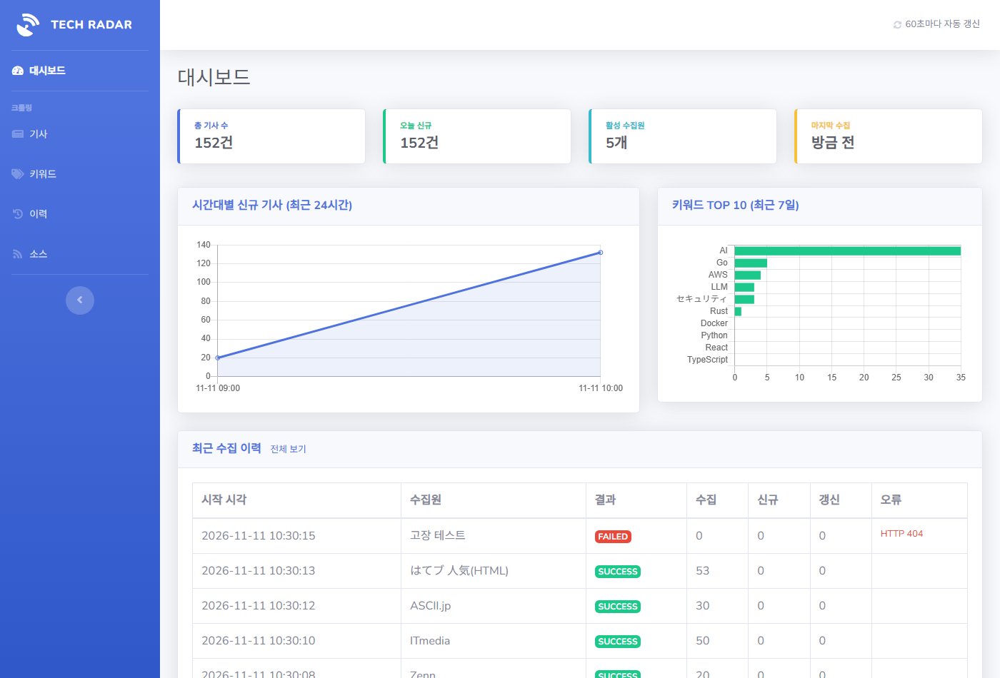
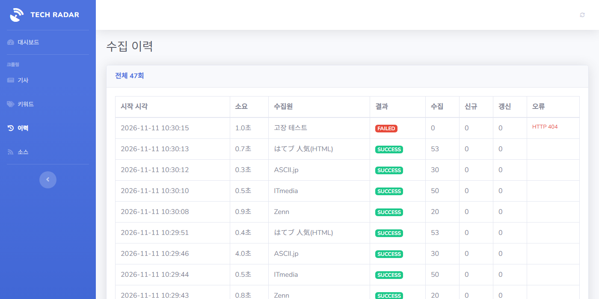
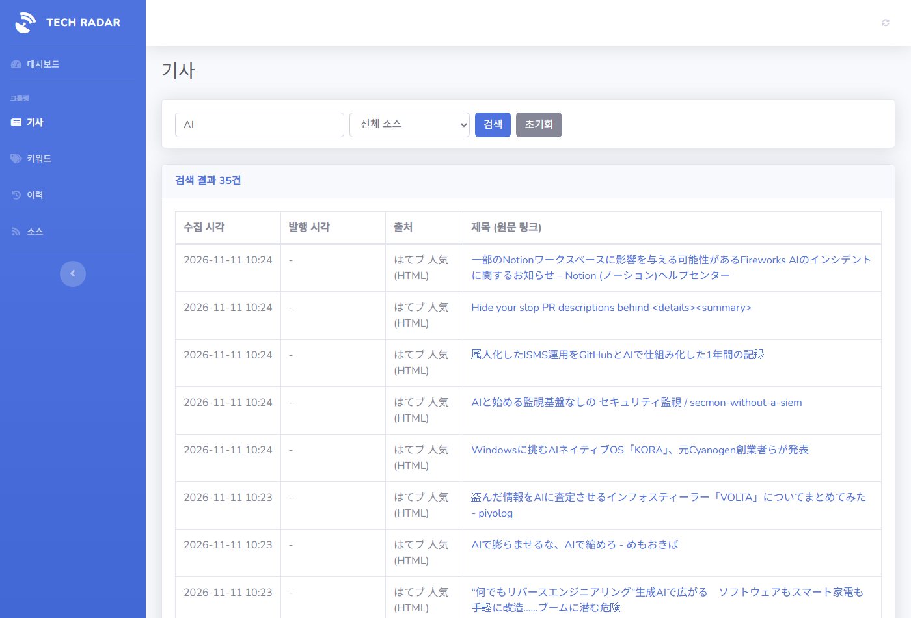
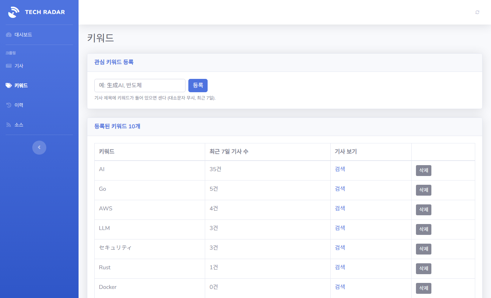
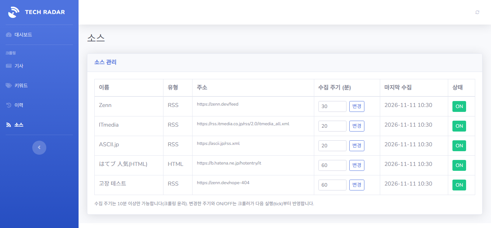

# YNC Tech Radar

일본 IT 기사를 RSS와 웹 페이지(HTML)에서 주기적으로 수집해 PostgreSQL에 저장하고, Spring Boot 대시보드로 보여 주는 2주 프로젝트입니다.

```
crawler/   Node.js 수집기 (src/, schema.sql, seed.sql, .env.example)
web/       Spring Boot + Thymeleaf + SB Admin 2 대시보드
docs/      context.md, prompt-log.md, screenshots/
```

## 1. 실행 순서

DB → schema · seed → crawler → web 순서로 실행합니다. (JDK 21, Node 20, Docker 필요)

```bash
# 1) DB
docker run -d --name radar-db -e POSTGRES_USER=radar -e POSTGRES_PASSWORD=radar1234 \
  -e POSTGRES_DB=radar -p 5432:5432 postgres:16

# 2) schema · seed
docker exec -i radar-db psql -U radar -d radar < crawler/schema.sql
docker exec -i radar-db psql -U radar -d radar < crawler/seed.sql

# 3) crawler
cd crawler
cp .env.example .env
npm install
npm run once     # 활성 소스를 한 번씩 수집 (테스트용)
npm start        # 1분 tick, 소스별 interval_min 이 지난 소스만 수집

# 4) web (다른 터미널)
cd web
DB_PASSWORD=radar1234 ./gradlew bootRun
```

http://localhost:8080 에서 확인합니다. DB 비밀번호는 환경변수(`DB_PASSWORD`)로만 받고, `.env`는 커밋하지 않습니다. 선택 설정은 `DB_URL`, `DB_USER`입니다.

화면: 대시보드(`/`), 기사(`/articles`), 키워드(`/keywords`), 이력(`/runs`), 소스(`/sources`).

### 서버 배포 (Java 17, Node 20, PostgreSQL 서버 기준)

웹 jar는 Java 17용으로 컴파일됩니다(`web/build.gradle`의 `options.release = 17`). 비밀번호는 코드나 Git이 아니라 서버의 환경변수와 `crawler/.env`로만 넘깁니다.

```bash
# 서버에서 DB 준비
psql -h localhost -U <DB계정> -d <DB이름> -f crawler/schema.sql
psql -h localhost -U <DB계정> -d <DB이름> -f crawler/seed.sql

# 크롤러 (crawler/.env 의 DATABASE_URL 을 서버 DB로 수정)
cd crawler && npm install && nohup npm start > crawler.log 2>&1 &

# 웹 (포트는 서버에서 배정받은 값)
DB_URL=jdbc:postgresql://localhost:5432/<DB이름> DB_USER=<DB계정> DB_PASSWORD='<비밀번호>' SERVER_PORT=<포트> \
  nohup java -jar radar-web-0.0.1-SNAPSHOT.jar > web.log 2>&1 &
```

## 2. 수집 소스 표와 크롤링 윤리 체크리스트

| 소스 | 유형 | 주소 | 주기 |
|---|---|---|---|
| Zenn | RSS | `https://zenn.dev/feed` (인기 글, 하루 약 5건) | 30분 |
| ITmedia | RSS | `https://rss.itmedia.co.jp/rss/2.0/itmedia_all.xml` | 20분 |
| ASCII.jp | RSS | `https://ascii.jp/rss.xml` | 20분 |
| はてなブックマーク IT 인기 | HTML | `https://b.hatena.ne.jp/hotentry/it` (선택자 `h3.entrylist-contents-title > a`, `Crawl-delay: 5`) | 60분 |

- [x] 1. robots.txt 확인: Zenn(`/search`만 금지), ASCII.jp(특정 경로 하나만 금지), はてブ(내부 API 경로만 금지)는 직접 확인했습니다. **ITmedia는 피드 주소에 robots.txt가 없어 확인하지 못했습니다.**
- [ ] 2. 이용약관의 크롤링 금지 조항: 약관 원문은 확인하지 못했습니다. 제출 전 소스마다 직접 확인해야 합니다.
- [x] 3. 요청 간격 최소 1초(소스 사이 `sleep(1000)`), 수집 주기는 소스당 최소 10분(DB `CHECK (interval_min >= 10)`, 화면에서도 10분 미만은 거부)
- [x] 4. User-Agent에 학생 프로젝트임을 밝힘: `YNC-TechRadar-Student/1.0 (edu)`
- [x] 5. 로그인이 필요한 페이지는 수집하지 않음(공개 RSS와 공개 목록 페이지만 사용)
- [x] 6. 개인정보는 수집하지 않음(제목, 링크, 요약, 발행 시각만 저장)
- [x] 7. 본문 전체가 아닌 제목, 링크, 요약만 저장(요약은 300자까지)
- [x] 8. 화면에 원문 링크와 출처를 함께 표시(기사 목록의 "출처", "제목 (원문 링크)", 새 탭으로 열림)

## 3. 갱신 규칙 R1~R8 구현 위치

| 규칙 | 구현 |
|---|---|
| R1 처음 보는 url은 INSERT(신규) | `crawler/src/repo.js` `upsertArticle`: `INSERT ... ON CONFLICT (url)`, `xmax = 0`이면 신규 |
| R2 url이 같고 내용이 바뀌면 `updated_at` 갱신(갱신) | 같은 UPSERT: 저장된 `title`, `summary`, `content_hash`(sha256(title\|summary)) 중 하나라도 새 값과 다를 때만 `updated_at = now()` |
| R3 url이 같고 내용이 같으면 `last_seen_at`만 갱신(기존) | 같은 UPSERT: `last_seen_at = now()`만 바뀜 |
| R4 `last_crawled_at + interval_min`이 지난 소스만 수집 | `crawler/src/index.js` SELECT 조건 |
| R5 `enabled = false`인 소스는 수집하지 않음 | 같은 SELECT 조건. 화면의 ON/OFF가 이 값을 바꿈 |
| R6 이전 수집이 끝나지 않았으면 건너뜀 | `index.js`의 `running` 플래그와 `node-cron`의 `noOverlap` |
| R7 한 소스가 실패해도 나머지는 계속, FAILED + 에러 기록 | `crawler/src/crawl.js` `try/catch`, `finishRun(..., 'FAILED', ..., e.message)` |
| R8 요청 사이 1초 대기, 타임아웃 10초, 실패해도 `last_crawled_at` 갱신 | `sleep(1000)`, `AbortSignal.timeout(10000)`, `finally { touchSource }` |

같은 url을 두 소스가 가리키면 먼저 저장한 소스가 그 기사의 주인입니다(`WHERE article.source_id = EXCLUDED.source_id`). 소스끼리 제목을 덮어쓰며 매번 "갱신"으로 잡히는 것을 막기 위한 규칙입니다.

## 4. 운영 결과 (2026-11-11 10:33 기준)

| 항목 | 값 |
|---|---|
| 총 실행 횟수 | 70회 |
| 성공률 | 100% (70/70) |
| 수집 건수 | 신규 153건, 갱신 80건 (현재 저장된 기사 153건) |

개발 중 수동으로 `npm run once`와 스케줄러를 짧게 돌린 결과이고, 시연용으로 일부러 고장 낸 소스의 실행 이력은 지웠습니다. 장시간(3시간 이상) 가동한 운영 결과가 아니므로 제출 전에 `npm start`를 켜 둔 뒤 아래 쿼리로 다시 집계하세요.

```sql
SELECT count(*) AS runs,
       count(*) FILTER (WHERE status = 'SUCCESS') AS ok,
       round(100.0 * count(*) FILTER (WHERE status = 'SUCCESS') / count(*), 1) AS success_pct,
       sum(inserted_count) AS inserted, sum(updated_count) AS updated
FROM crawl_run;
```

## 5. 사용한 AI 도구와 "AI가 틀려서 고친 사례" Best 3

사용한 도구: Claude Code (Claude Sonnet 5.5). 프롬프트 기록은 [docs/prompt-log.md](docs/prompt-log.md)에 있습니다.

1. **신규/갱신 판정이 항상 "기존"으로 나옴** (R2): AI가 `RETURNING (article.content_hash IS DISTINCT FROM EXCLUDED.content_hash)`로 변경 여부를 계산했는데, `RETURNING`에서는 `article.content_hash`가 이미 새 값이라 항상 false였습니다. 제목을 DB에서 고쳐 `once`를 돌려 보고 발견했고, `(article.updated_at = now())`로 판정하도록 고쳤습니다.
2. **404 소스가 있으면 `npm run once`가 끝나지 않음** (R7): `rss-parser`의 `parseURL`이 오류 응답 뒤에도 연결을 열어 둬서 프로세스가 종료되지 않았습니다. `fetch`(타임아웃 10초, `res.ok` 검사)로 받고 `parseString`으로 파싱하도록 바꿨습니다.
3. **HTML 소스가 다른 소스의 기사를 덮어씀** (R2, R3): HTML 목록의 일부 글이 RSS 소스에도 있어서, 수집할 때마다 제목과 요약을 서로 덮어쓰며 "갱신 9"가 계속 찍혔고 요약이 비었습니다. 같은 url은 먼저 저장한 소스만 갱신하도록 UPSERT에 `WHERE article.source_id = EXCLUDED.source_id`를 넣었습니다.

## 6. 화면 캡처

| 대시보드 | 수집 이력 (FAILED 예시) |
|---|---|
|  |  |

| 기사 검색 | 키워드 등록 | 소스 관리 |
|---|---|---|
|  |  |  |

수집 이력 캡처의 FAILED 행은 시연 시나리오 4번(소스 URL 고장)을 재현한 것입니다.

## 요구사항 체크리스트

### 수집기 (C1~C7)
- [x] C1 RSS 수집 (`fetchers.js`)
- [x] C2 HTML 수집, 상대 URL을 절대 URL로 변환 (`fetchers.js`, はてブ HTML 소스)
- [x] C3 `url` 기준 UPSERT (`repo.js`)
- [x] C4 1분 tick + 소스별 `interval_min` (`index.js`)
- [x] C5 `crawl_run` 실행 이력 (`repo.js`, `crawl.js`)
- [x] C6 겹침 방지, 요청 간격, 실패 격리
- [x] C7 `npm run once`

### 대시보드 (D1~D7)
- [x] D1 요약 카드(총 기사, 오늘 신규, 활성 소스, 마지막 수집 "n분 전") + 수집기 정지 의심 배지(마지막 수집이 가장 짧은 주기의 2배 초과)
- [x] D2 기사 목록: 제목 검색, 소스 필터, 서버 페이징 (`/articles`)
- [x] D3 시간대별 신규 기사 line 차트
- [x] D4 키워드 TOP 10 bar 차트, 관심 키워드 등록과 삭제 (`/keywords`)
- [x] D5 실행 이력: SUCCESS/FAILED 배지, 에러 메시지 (`/runs`, 대시보드 최근 10건)
- [x] D6 소스 관리: ON/OFF, 수집 주기 변경(10분 이상) (`/sources`)
- [x] D7 60초 자동 새로고침 (`<meta http-equiv="refresh">`)

## 시연 시나리오 (1인 5분)

| # | 내용 | 확인 |
|---|---|---|
| 1 | `npm run once` → 콘솔에 소스별 신규 N건 | C1~C3 |
| 2 | `once` 한 번 더 → 신규 0건 | R1, R3 |
| 3 | DB에서 title 수정 → `once` → 갱신 1건 | R2 |
| 4 | 소스 URL 고장 → 그 소스만 FAILED | R7 |
| 5 | 이력 화면에 FAILED + 에러 | D5 |
| 6 | 대시보드 카드, 마지막 수집 n분 전 | D1 |
| 7 | 기사 검색(일본어 키워드 포함) | D2 |
| 8 | 키워드 추가 → TOP 차트 반영 | D4 |
| 9 | 소스 OFF → 다음 tick에서 제외 | D6, R5 |
| 10 | 코드 질문 2개 | 질의 |

3번과 4번 준비용 SQL:

```sql
UPDATE article SET title = 'changed' WHERE id = (SELECT min(id) FROM article);
INSERT INTO source (name, type, url, interval_min) VALUES ('고장 테스트', 'RSS', 'https://zenn.dev/nope-404', 60);
```
